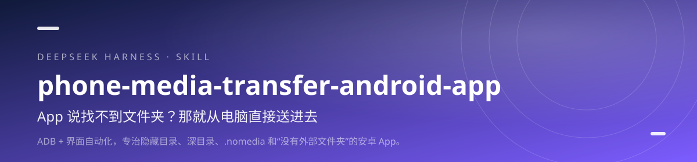

<div align="center">



<h1>phone-media-transfer-android-app · 安卓媒体搬运</h1>

<p><b>App 说找不到文件夹？那就从电脑直接送进去。</b></p>

<p>ADB + 界面自动化，专治隐藏目录、深目录、.nomedia 和“没有外部文件夹”的安卓 App。</p>

[](https://github.com/lilinshuei/phone-media-transfer-android-app/actions/workflows/validate.yml)
[](LICENSE)
[](https://www.npmjs.com/package/phone-media-transfer-android-app)
[](https://github.com/topics/dsh-plugin)
[](#环境要求)

</div>

---

## 它解决什么问题

安卓 App 的存储位置千奇百怪：有的藏在 Android/data 五层目录里，有的被 .nomedia 屏蔽，有的根本没有外部文件夹，只认它自己的导入按钮。

这个 Skill 先用 ADB 把存储结构和数据库索引摸清楚，再按四种类型选路线：目录扫描、数据库索引、媒体库刷新、界面自动化。能直接复制就复制，复制不了才去点界面。

## 你会得到什么

- **先判型，再动手** — 四种路线命中即停，避免“文件塞进去了但 App 永远不认”。
- **深度 5 探测** — 连隐藏目录、.nomedia 标记、数据库里记录的真实路径一起挖出来。
- **导出是复制不是移动** — 不破坏 App 的数据库索引；同名文件自动加序号。
- **界面自动化兜底** — 文件系统不可达时，用 ui_auto.ps1 按文字找按钮、滚动查找、等待元素。
- **说清硬边界** — 无 root 不碰 /data/data 与加密保险箱，不假装能“破解”。

## 安装

### npm 一行安装（推荐）

```powershell
dsh plugin --profile web add phone-media-transfer-android-app
```

在 DSH 桌面端的「添加插件」窗口里，只填包名 `phone-media-transfer-android-app`，不要粘贴整条命令。

包已发布到 npm registry，命令最短，也不依赖 GitHub 访问。桌面端把 `web` 换成 `desktop`；装完重启 DSH，新会话即可调用。

### 从 GitHub 安装

```powershell
dsh plugin --profile web add github:lilinshuei/phone-media-transfer-android-app
```

想跟最新提交，或 npm 拉取不畅时用这条。

### 手动安装

```bash
git clone https://github.com/lilinshuei/phone-media-transfer-android-app.git
mkdir -p ~/.dsh/skills
cp -r phone-media-transfer-android-app ~/.dsh/skills/
```

最终路径是 `~/.dsh/skills/phone-media-transfer-android-app/SKILL.md`。仓库根目录就是 Skill 本体，不用再找子目录。

## 快速上手

### 1. 确认设备与目标 App

```bash
adb devices
adb push scripts/app_identify.sh /data/local/tmp/
adb shell "sh /data/local/tmp/app_identify.sh"
```

输出 mCurrentFocus 里的 com.xxx.yyy 就是包名。

### 2. 彻底探测

```bash
adb push scripts/app_probe.sh /data/local/tmp/
adb shell "sh /data/local/tmp/app_probe.sh com.xxx.yyy 关键词"
```

看目录树、.nomedia、媒体样本、数据库路径与总体积。

### 3. 导出或导入

```bash
adb push scripts/app_export.sh /data/local/tmp/
adb shell "sh /data/local/tmp/app_export.sh com.xxx.yyy '/sdcard/导出' 关键词 all"
```

导入时按探测结果选目录；媒体库型再跑 media_rescan.sh。

## 能力边界

- 无 root 无法访问 /data/data/<包名> 与系统级加密保险箱。
- 导出是复制，不是移动；删原文件会让 App 的数据库条目失效。
- 界面自动化依赖当前界面文字与控件，App 大改版后可能需要重新找标签。
- 请只对自己拥有或已获授权的内容使用，不要绕过付费或版权限制。

## 环境要求

| 项 | 要求 |
|---|---|
| 电脑 | 安装 ADB，并加入 PATH |
| 手机 | 开启开发者选项与 USB 调试 |
| 权限 | 只对已授权设备与 App 操作 |
| root | 不需要；但无 root 也意味着有硬边界 |

## 仓库里有什么

```
phone-media-transfer-android-app/
├── scripts/app_identify.sh
├── scripts/app_probe.sh
├── scripts/app_export.sh
├── scripts/media_rescan.sh
├── scripts/ui_auto.ps1
├── references/android-app-storage.md
├── lib/index.js          # DSH 插件适配层（零依赖）
├── cordis.patch.yml      # DSH 挂载声明
├── tools/                # 仓库自检 + 适配层冒烟测试
└── README.md
```

- scripts/app_identify.sh — 读前台包名
- scripts/app_probe.sh — 深度探测目录、媒体与数据库路径
- scripts/app_export.sh — 复制导出，不破坏索引
- scripts/media_rescan.sh — 刷新系统媒体库
- scripts/ui_auto.ps1 — 界面自动化：dump / tap / scrollfind / wait
- references/android-app-storage.md — 安卓存储结构与判型细节

## 安全与隐私

- **零遥测**：不上报使用数据、不内置统计、不访问外部接口。
- **本地执行**：所有处理都在你的机器上完成；需要联网时只发生在你自己执行的包管理器或下载命令里。
- **不删文件**：仓库脚本以“只新增、不删除”为约束；需要清理时会先说明并留回退路径。
- **无凭据**：仓库不包含账号、令牌、Cookie 或本机绝对路径。发现问题请按 [SECURITY.md](SECURITY.md) 私下报告。

## 同系列 Skill

| Skill | 一句话 |
|---|---|
| **[novel-atlas](https://github.com/lilinshuei/novel-atlas)** | 把一本小说，变成一座可以走进去的世界。 |
| **[pc-privacy-shield](https://github.com/lilinshuei/pc-privacy-shield)** | 你的屏幕看得见，别人的截屏看不见。 |
| **[blank-workbench](https://github.com/lilinshuei/blank-workbench)** | 一句话，得到一个能直接干活的工作台。 |
| **[task-complete-chime](https://github.com/lilinshuei/task-complete-chime)** | 任务跑完了，别再盯着屏幕等。 |
| **[source-to-app](https://github.com/lilinshuei/source-to-app)** | 源码到双击即用，只差这一条命令。 |

## License

MIT © 2026 lilinshuei。本 Skill 为原创设计；第三方依赖与素材在各自目录内单独标注。

---

如果它替你省下了时间，点一个 **Star**，让更多人找到它。
